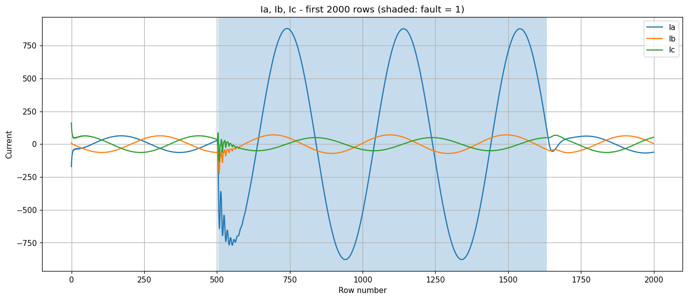
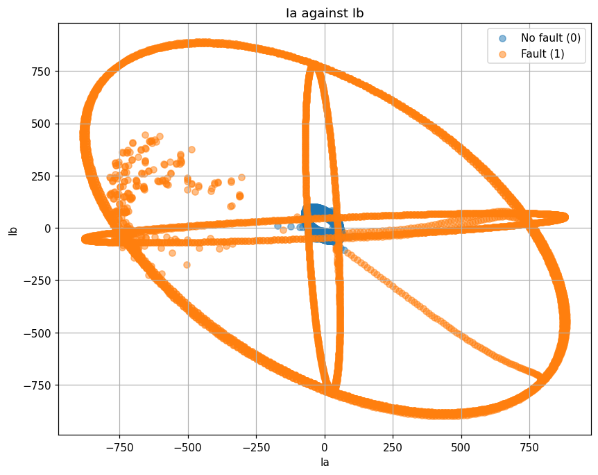
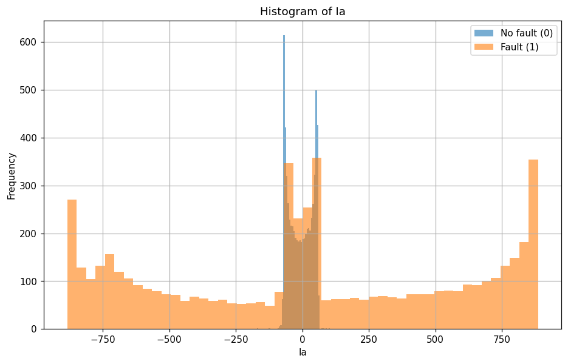
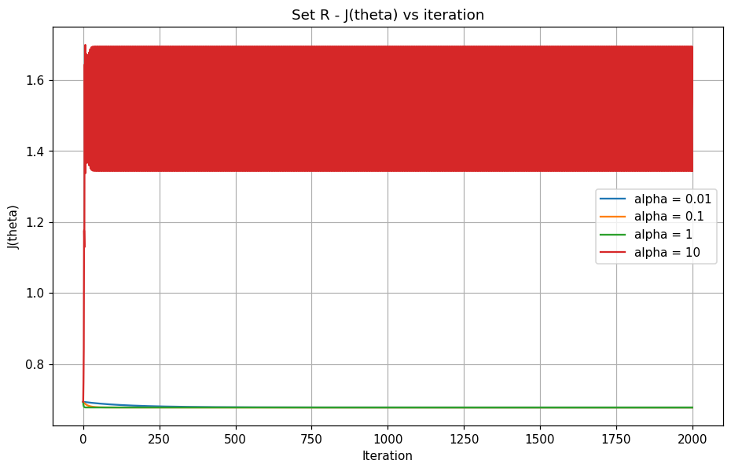
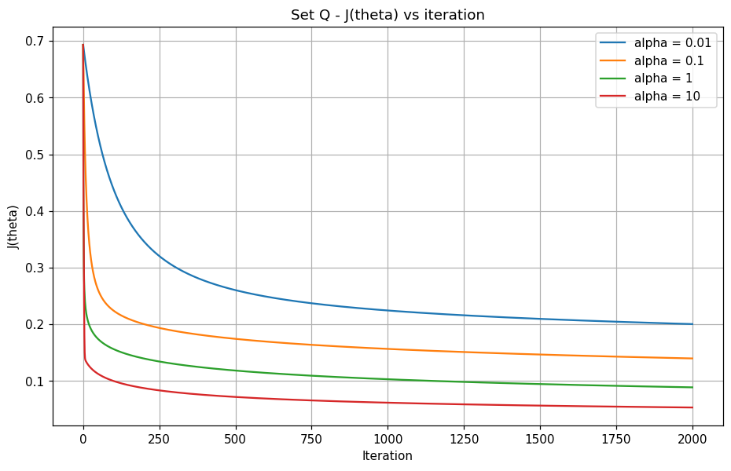
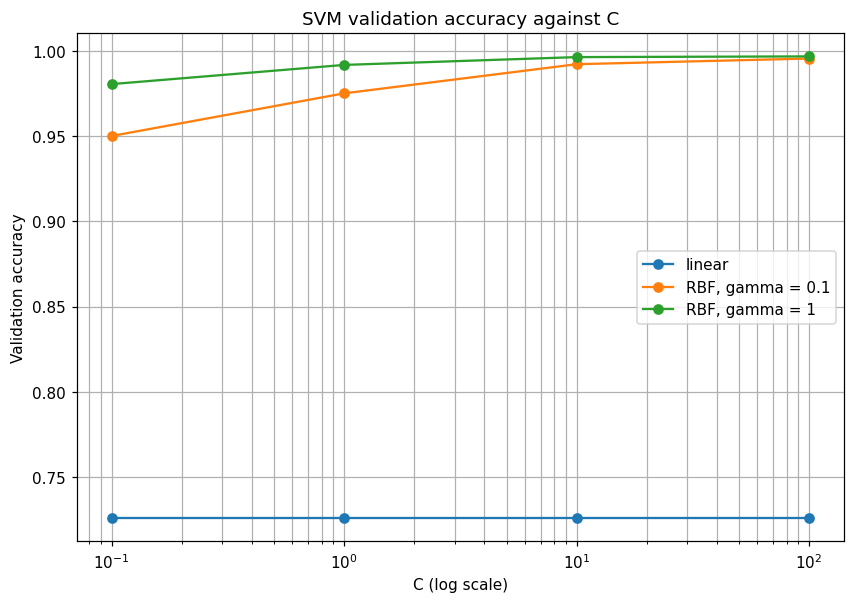

# Teaching a Computer to Spot a Short Circuit: Why Straight Lines Fail on Power-Line Faults

*Laiba Afzaal (23F-6073) and Muhammad Ali (23F-6020) · Applied Machine Learning · Code: [GitHub repo link]*

A transmission-line protection relay has one job: if a fault happens, open the breaker, and if nothing is wrong, do nothing. Getting this wrong in one direction damages equipment. Getting it wrong in the other direction causes an unnecessary blackout. We built and compared machine-learning detectors on a public Kaggle dataset to see which approach is good enough for the job, and what the data says about *why*.

## The problem and the data

The dataset has 12,001 rows. Each row is one instant of a three-phase power line: three currents (Ia, Ib, Ic) and three voltages (Va, Vb, Vc), plus a label `fault` (1 = fault, 0 = no fault). After removing two completely empty columns (`Unnamed: 7` and `Unnamed: 8`) and renaming the label, we had 5,496 fault rows and 6,505 no-fault rows and no missing values. We split the rows randomly 60/20/20 (seed 42) into 7,200 training, 2,400 validation and 2,401 test rows, and standardised every feature using training statistics only.

| Item | Value |
|---|---|
| Raw rows / columns | 12001 / 9 |
| Columns removed | Unnamed: 7, Unnamed: 8 |
| Fault / no-fault rows | 5496 / 6505 |
| Train / validation / test | 7200 / 2400 / 2401 |
| Fault fraction (train / val / test) | 0.461 / 0.451 / 0.456 |

## What a fault looks like

The first 2,000 rows are consecutive time samples. The shaded region is a fault, and the change is dramatic: Ia jumps from about ±60 to about ±880, after a burst of high-frequency transients at the start.

In the (Ia, Ib) plane the two classes overlap heavily around the centre. The sinusoid swings through zero, so a *faulted* sample can sit at 0 and a healthy sample can be positive or negative. A single straight line cannot separate them. What distinguishes the classes is **how big** the waveform is, not **which side of zero** a sample is on.

## Logistic regression from scratch

We wrote logistic regression by hand with NumPy: sigmoid, cost J(θ), and batch gradient descent. We tried α ∈ {0.01, 0.1, 1, 10} for 2,000 iterations and chose the largest α for which J fell at *every* iteration.

On the six standardised measurements (**Set R**), α = 10 diverges (its cost went up), so α = 1 was chosen. J only fell to 0.677, barely below log 2 ≈ 0.693, the cost of knowing nothing.

Then we built **Set Q**: the six raw values plus their six squares (squares taken from raw values *before* standardising, 12 features in total).

Now every α is stable and α = 10 is best, with J down to 0.053.

## Support vector machines

We trained linear SVMs (C ∈ {0.1, 1, 10, 100}) and RBF SVMs (the same C values, γ ∈ {0.1, 1}) on Set R, using scikit-learn.

| Kernel | C | γ | Validation acc. | Support vectors |
|---|---|---|---|---|
| linear | 0.1 / 1 / 10 / 100 | – | 0.7258 / 0.7258 / 0.7258 / 0.7262 | 5849 / 5843 / 5835 / 5835 |
| rbf | 0.1 / 1 / 10 / 100 | 0.1 | 0.9500 / 0.9750 / 0.9921 / 0.9954 | 1347 / 723 / 381 / 174 |
| rbf | 0.1 / 1 / 10 / 100 | 1 | 0.9804 / 0.9917 / 0.9962 / 0.9967 | 848 / 482 / 342 / 266 |

We picked the best of each kernel on the **validation** set (linear C = 100, RBF C = 100, γ = 1) and touched the test set only once.

## Results on the test set

| Model | Accuracy | TN | False alarms | Missed faults | TP |
|---|---|---|---|---|---|
| Logistic regression, Set R | 72.64 % | 1305 | 0 | 657 | 439 |
| Logistic regression, Set Q | 97.88 % | 1299 | 6 | 45 | 1051 |
| Linear SVM (C = 100) | 73.64 % | 1305 | 0 | 633 | 463 |
| RBF SVM (C = 100, γ = 1) | 99.58 % | 1301 | 4 | 6 | 1090 |

The two linear models score the same, about 73 %. Adding squares to logistic regression lifts it to 97.9 %, and the RBF SVM reaches 99.6 %.

## Answers to the analysis questions

**Why do logistic regression (Set R) and the linear SVM score almost the same?** Both draw a straight boundary; they only differ in how they choose it. If no good straight boundary exists, both land on a similarly poor one (72.6 % vs 73.6 %, and changing C did nothing). So the data are **not linearly separable**: a fault changes the *amplitude* of the waveform, not the sign of one sample.

**What are the signs of the I² and V² weights in Set Q?** The I² weights are **positive** (Ia² +18.9, Ib² +4.8, Ic² +14.0) and the V² weights are **negative** (−6.0, −6.5, −6.1). In a fault, a short-circuit path opens up and current surges, so large I² means fault. At the same time the voltage at the relay collapses, so large V² means healthy. High current plus low voltage is the signature of a short circuit, and the model rediscovered it.

**How many support vectors do the best linear and RBF SVMs use?** The linear SVM uses 5,835 (81 % of the training rows) and the RBF SVM only 266 (3.7 %). A huge support-vector count means most points are inside the margin or misclassified: the model cannot find a clean gap and is too simple for the data. It also makes prediction slow.

**What happens as C increases?** For the RBF SVM, accuracy rises (γ = 1: 0.980 → 0.992 → 0.996 → 0.997) and support vectors fall (848 → 482 → 342 → 266). C is the penalty for margin violations: a small C allows a wide, smooth margin with many points inside it (many support vectors, underfitting), a large C shrinks the margin and bends the boundary to classify points correctly (fewer support vectors). The linear SVM cannot bend, so C changes nothing. The last step (C 10 → 100) gained only one validation row, so it is noise.

**Is our test accuracy optimistic or pessimistic?** **Optimistic.** The rows are consecutive samples, so a random split puts near-identical neighbours in both train and test; a flexible model gets credit for having effectively seen the sample before. A real relay meets new fault locations, resistances and inception angles, and the hardest moments (fault start and clear) are rare in a random test set. Splitting by contiguous time block or by fault event would be a fairer test, and we would expect lower scores.

**Which model would we deploy?** The **RBF SVM**. A missed fault is the dangerous error: the breaker fails to trip. The linear models have zero false alarms but miss about 58–60 % of faults, so they are useless for protection. Logistic regression on Set Q misses 45 faults (4.1 %); the RBF SVM misses 6 (0.55 %) with only 4 false alarms. Before deployment we would re-test with a time-block split, bias the threshold slightly towards "fault", require several consecutive fault samples before tripping, and keep Set-Q logistic regression as an interpretable cross-check.

## Try it yourself

We built a small Flask web app: enter Ia, Ib, Ic, Va, Vb, Vc and see the Set-Q logistic regression and the RBF SVM predict side by side.

## Takeaways

1. A model's accuracy depends on whether its *shape* matches the physics. Squaring the features took logistic regression from 73 % to 98 %.
2. Two different linear algorithms giving the same score is a clue about the data, not a coincidence.
3. For protection, count **missed faults**, not just accuracy.
4. A random split of time-series samples can overstate real-world performance.

Code, notebook and tables: [GitHub repo link]
